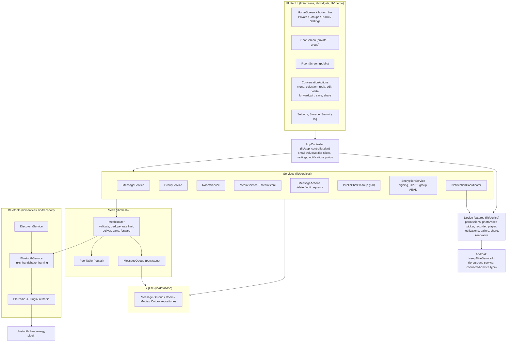

# Architecture

دەمەتەقێ (Damatqe) is a Flutter app that sends private messages, group messages and public-room messages
between phones **over Bluetooth Low Energy only**, with multi-hop store-and-forward. Nothing needs
the internet, an account or a server.

> The specification an earlier version followed calls the app "GhostChat". The app is called
> **دەمەتەقێ** (Damatqe) and has a Telegram-inspired look, dark or light ([ui-design.md](ui-design.md)). See
> `feature-status.md` ("Deviations from the specification") for this and the other differences, and
> the reasons.

## 1. Layers

The **dependency rule**: the UI talks to `AppController`; the controller talks to services; services
talk to repositories and to the router; the router talks to the transport interface. The mesh and
protocol code know nothing about Flutter widgets, and the UI never touches Bluetooth or SQL.

Words the person reads are the one exception to "services know nothing about the UI": a service that has
to explain something (a message that is too long, a picture that could not be saved) is given the current
strings (`ServiceContext.strings`, a function, so a language change applies at once). What is *stored* is
never worded: the last-message line of a chat is a small structure (`MessagePreview`) and the reason a
message failed is a code (`DeliveryProblem`), both turned into words when drawn. See `localization.md`.

## 2. Mapping to the structure the specification suggests

| Specification module | Where it lives here |
| --- | --- |
| core | `lib/core/` (clock, bytes, text sanitising, logging, formatting) |
| models | `lib/models/` (conversation, message, peer, group, room, media) |
| database + repositories | `lib/database/` (`database_helper.dart` holds schema and migrations; one repository per area) |
| messaging | `lib/services/message_service.dart`, `group_service.dart`, `room_service.dart` |
| mesh_network | `lib/mesh/` (router, queue, duplicate filter, rate limiter, relay manager, peer table) and `lib/protocol/` (packet and envelope formats) |
| bluetooth | `lib/transport/`, `lib/services/bluetooth_service.dart`, `discovery_service.dart`, `plugin_ble_radio.dart` |
| encryption | `lib/crypto/` (HPKE, AEAD, HKDF, signatures, key store), `lib/services/encryption_service.dart`, `group_keyring.dart`, `secure_key_store.dart` |
| media | `lib/services/media_service.dart`, `media_store.dart`, `lib/protocol/media_chunk.dart`, `lib/device/image_tools.dart`, `lib/widgets/media_views.dart`, `lib/screens/video_player_screen.dart` |
| notifications | `lib/device/notifications.dart` (system notifications), `lib/services/notification_coordinator.dart` (when and what) |
| background_services | `lib/device/keep_alive.dart` and `android/.../KeepAliveService.kt`; the relay switch is `MeshRouter.relayForOthers` |
| private_chat / public_chat | `lib/screens/chat_screen.dart`, `room_screen.dart` and the services above |
| message_actions / message_deletion / message_editing | `lib/services/message_actions.dart` (requests and their authorisation), `lib/screens/conversation_actions.dart` (what the UI does with them) |
| message_search | `MessageRepository.searchMessages`, `lib/screens/message_search_screen.dart` |
| public_chat_cleanup | `lib/services/public_chat_cleanup.dart` and `MessageRepository.removeExpiredPublic` |
| voice_call | **design document only**: `docs/voice-calls-design.md` |
| settings | `lib/screens/settings_screen.dart`, `storage_screen.dart` |
| ui | `lib/screens/`, `lib/widgets/`, `lib/theme/` |
| languages (not in the specification) | `lib/l10n/` (the three `.arb` files, generated `AppLocalizations`, `AppLanguage`, the Kurdish framework words, labels), `lib/core/bidi.dart` and `byte_limit.dart`, `lib/widgets/ltr.dart` and `language_picker.dart`; see `localization.md` |

Native code: `android/app/src/main/kotlin/.../KeepAliveService.kt` and `MainActivity.kt` (a small method
channel). There is **no Swift code**: Bluetooth, notifications, photos and the share sheet go through
Flutter plugins on iOS, and the iOS side has never been built or run.

## 3. How a message travels

### Sending (private chat)

1. The UI calls `AppController.sendText` -> `MessageService.sendDirect`.
2. The message is **written to the database first** as `queued` (so it survives a restart and Bluetooth
   being off).
3. `EncryptionService` seals it with HPKE to the recipient's key and signs the packet.
4. The packet goes into the persistent queue (`outbox` table). The router offers it to a neighbour that is
   the recipient or on the route to the recipient, now and on every flush.
5. When a neighbour has taken it, the message becomes `sent`. When the recipient's signed receipt comes
   back, it becomes `delivered`. If its lifetime (12 h) runs out first, it becomes `failed` with a
   "send again" button.

### Receiving

1. A packet arrives over a link. The router checks size, rate, structure, expiry, duplicates, the sender
   rate, and the **signature**. Only then is it marked as seen.
2. If it is for this phone, `MessageService` opens it (HPKE), **stores the message**, queues a signed
   receipt, and only then tells the notification coordinator.
3. If it is for somebody else and relaying is on, the router queues it for the next hop. It cannot read it.

### Edits and deletions

A delete or edit request is an ordinary message of the same conversation (sealed or signed the same way),
handled by `MessageActions`. The receiver accepts it only from the message's author (or the group admin
for deletion). See `security.md`, section 6.

## 4. State and storage

* **Database**: one SQLite file (see `database.md`). Everything that must survive: conversations, messages,
  media records, the outgoing queue, deletion records, pins, edits waiting for their message, settings.
* **Files**: pictures, videos and voice messages in `media/` inside the app's private folder.
* **Key store**: identity and group keys in the Android Keystore / iOS Keychain.
* **Memory only**: the peer table and routes (they expire in about 100 s anyway), the in-app log, the
  state of the radio.

## 5. Concurrency and change notification

Repositories publish `DataChange` events on a bus. `AppController` listens, coalesces bursts, and updates
a few `ValueNotifier` slices (conversations, peers, groups, rooms, unread count, network). A conversation
screen has its own `ConversationFeed` that reloads only its messages, pins and media when they change, and
publishes a new state only when something the screen shows is different. Widgets listen to the smallest
slice they need; typing and keyboard animation do not rebuild the message list (a test counts rebuilds).

## 6. Testing seams

Everything platform-specific is behind an interface with a fake in `test/support/`: `BleRadio`
(`FakeBleWorld` simulates phones in and out of range), `MediaStore`, `PermissionService`, `PhotoPicker`,
`VoiceRecorder`/`VoicePlayer`, `NotificationSink`, `KeepAlive`, `GallerySaver`, `Sharer`, `Clock`. This is why
the tests can run a whole conversation between simulated phones, but also why they **cannot** show how a
real radio, a real Android version or a real battery manager behaves (see `testing.md`).
