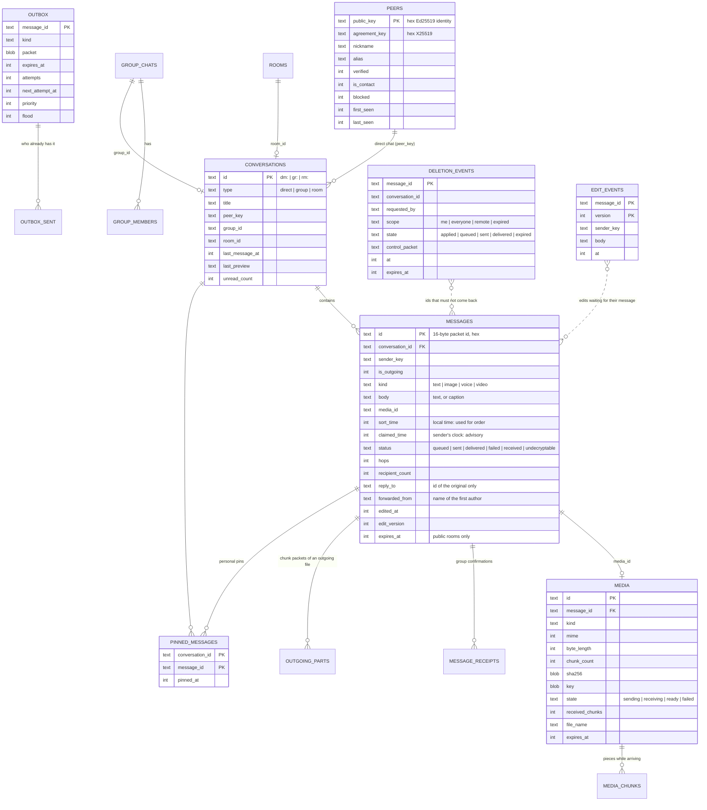

# Database: relationship diagram, schema, migrations

Storage is **SQLite through `sqflite`** (schema version **3**), in one file, `offline_mesh_chat.db`, in the
app's private support folder. The specification asks for Drift; see "Why sqflite and not Drift" below.

The authoritative definition is `lib/database/database_helper.dart`
(`DatabaseHelper.schemaStatements`). The tests open the **production schema and SQL** on an in-memory
SQLite (`sqflite_common_ffi`) or on a real file.

## 1. Relationship diagram

Not drawn for space: `seen_messages` (ids already processed, with expiry), `security_events`, `settings`
(key/value), `group_chats` / `group_members`, `rooms`, `public_chat_cleanups`, `media_chunks`,
`outgoing_parts`, `outbox_sent`.

## 2. How the specification's tables map onto this schema

| Specification table | Here | Notes |
| --- | --- | --- |
| `users` | `peers` | People this phone has met. **This phone's own identity is not in the database**: its keys are in the platform key store, only the public id is mirrored in `settings` to detect a lost key store |
| `devices` | *(none)* | A person is one key. Nearby *devices* are transient (a scan result is not a person) and kept in memory by `DiscoveryService` |
| `conversations` | `conversations` | Direct, group and public room, by `type` |
| `conversation_members` | `group_members` (+ `conversations.peer_key` for direct) | A public room has no member list (anyone may be in it) |
| `messages` | `messages` | One row per message; `status` is the delivery state |
| `message_attachments` | `media` (+ `media_chunks`) | One attachment per message, linked by `messages.media_id` and `media.message_id`; `media_chunks` hold pieces of a file that has not finished arriving |
| `pending_outbox` | `outbox` (+ `outbox_sent`, `outgoing_parts`) | The persistent queue: signed packets waiting for a route, and who already has each |
| `delivery_receipts` | `message_receipts` (groups) and `messages.status` / `hops` (private) | A private receipt turns the message `delivered`; a group message is `delivered` only when every other member's receipt is in |
| `peer_cache` | `peers` + the in-memory `PeerTable` | Routes are **deliberately not persisted**: a route is only believed for about 100 s |
| `transfer_sessions` | `media` (`state`, `received_chunks`) + `media_chunks` + `outgoing_parts` | The state of a file being sent or received, per chunk |
| `pinned_messages` | `pinned_messages` | **Personal** pins, see `security.md` |
| `deletion_events` | `deletion_events` | Minimal records so a removed message cannot return. Never shown as chat |
| `edit_events` | `messages.edit_version` / `edited_at` + `edit_events` | `edit_events` holds only edits that arrived **before** their message; applied and removed when it shows up |
| `public_chat_expirations` | `messages.expires_at` (public rooms only) + `public_chat_cleanups` | The expiry is per message; the second table logs when the cleanup ran |
| `encryption_metadata` | `peers.agreement_key`, `peers.verified`, `group_chats.epoch` | Secret keys are **not** in the database |

## 3. Constraints, indexes, integrity

* `PRAGMA foreign_keys = ON`. `messages.conversation_id -> conversations(id) ON DELETE CASCADE`;
  `media.message_id`, `message_receipts.message_id`, `outgoing_parts.message_id`,
  `pinned_messages.message_id` and `.conversation_id` all `ON DELETE CASCADE`, so removing a message removes
  everything that hangs off it, including its pins.
* Primary keys are the stable ids (random 16-byte packet ids, hex), so inserting the same message twice is
  a no-op: `MessageRepository.insertMessage` returns `false` for a duplicate or for an id that was removed.
* Indexes: `messages(conversation_id, sort_time)`, `messages(status)`, `messages(expires_at)`,
  `media(message_id)`, `media_chunks(received_at)`, `outbox(next_attempt_at)`, `outbox(sender_key)`,
  `outgoing_parts(message_id)`, `seen_messages(expires_at)`, `deletion_events(expires_at)` and
  `(control_packet)`, `pinned_messages(conversation_id, pinned_at)`.
* Writes that must be atomic (insert a message and update its conversation's preview and unread count;
  remove messages and everything attached, and record why) run in one transaction.
* A file is written under a temporary name and renamed; a file is removed only when no message refers to
  it (a sweep takes care of leftovers, except files being written at that moment).

## 4. What is guaranteed about saving

| Requirement | How it is met | Tested |
| --- | --- | --- |
| Save each outgoing message before transmission | `sendDirect` inserts the row (`queued`) before the packet is built and submitted | Yes (simulated) |
| Save incoming messages before notifying | The notice that feeds notifications is sent after `insertMessage` | Yes |
| Preserve messages after closing the app / restarting the phone | A real SQLite file is closed and reopened in tests; the queue is in the same file | Yes (real file, simulated radio). **Not** on a phone |
| Preserve queued messages when Bluetooth is off | The queue is in the database; the router resumes when links return | Yes (simulated) |
| Retry queued messages | `next_attempt_at`, flush every 5 s, route changes nudge the queue | Yes (simulated) |
| No duplicates | Stable ids, `seen_messages`, idempotent inserts | Yes |
| Interrupted operations and database errors | Transactions; unfinished media is given up after 12 h; orphan chunks are bounded | Yes for the logic. Disk-full and corruption on a phone were **not** tested |
| Export or backup | **Not implemented.** There is no export. If added, it must be an explicit user action, encrypted | n/a |

## 5. Migrations

`DatabaseHelper._onUpgrade` runs the steps in order. Both steps use only `ALTER TABLE ... ADD COLUMN`
and new tables, never a table rebuild: with foreign keys on, rebuilding a parent table would cascade-delete
the chat history.

| From | To | What changes |
| --- | --- | --- |
| 1 | 2 | Password channels are removed (a different security model). Queued v1 packets (old wire format) are dropped and the messages they belonged to marked failed with an explanation. `conversations` gain `group_id`, `room_id`; `messages` gain `kind`, `media_id`, `recipient_count`; `outbox` gains `priority`, `flood`; new tables for groups, rooms, media, receipts, outgoing parts |
| 2 | 3 | `messages` gain `reply_to`, `forwarded_from`, `edited_at`, `edit_version`, `expires_at`; new tables `pinned_messages`, `deletion_events`, `edit_events`, `public_chat_cleanups`; every existing public-room message gets its expiry (`sort_time` + 6 h), so what is overdue goes at the first cleanup. No existing row is deleted or rewritten otherwise |

Tests: `test/database/database_helper_test.dart` builds a real **v1** database (`test/support/legacy_schema.dart`
holds the v1 and v2 snapshots), upgrades it, and checks that history, queue and settings survive and that
a fresh install and an upgraded database have the same tables.

## 6. Retention and cleanup rules

| Data | Rule |
| --- | --- |
| Public-room messages | Removed 6 h after this phone sent or received them (`expires_at`); at start, on every maintenance round (about a minute), and on request. Only rows that carry an expiry **and** belong to a `room` conversation can be selected |
| Other messages | Kept until deleted, or by the "Keep messages" setting (forever / 1 / 7 / 30 days) |
| `deletion_events` | 48 h (longer than any packet lives), then forgotten. The memos of deletions other phones asked for (`scope = 'remote'`) are also capped at 5,000: the oldest go first |
| `edit_events` | Until their message arrives, at most 48 h, and at most 500: the oldest go first |
| Half-received media | 12 h |
| `seen_messages` | Until the packet's own expiry |
| `security_events` | The latest 300 |
| `public_chat_cleanups` | 30 days |

## 7. Why sqflite and not Drift

The specification says "SQLite with Drift". This project already had a complete, tested `sqflite` data
layer (hundreds of tests, a working v1 -> v2 migration, and repositories that the whole app depends on).
Rewriting it onto Drift would have replaced working, verified code for no change in behavior, and Drift's
code generation adds a build step this toolchain (Flutter 3.47, AGP 9.1) had not been checked against. The
specification allows adapting to the existing code base ("Preserve working code", "Adapt this structure to
the existing codebase"). The schema, constraints, indexes, migrations and repositories required by the
specification exist; only the library differs. If Drift is wanted later, the repositories are the only
files that would change.
